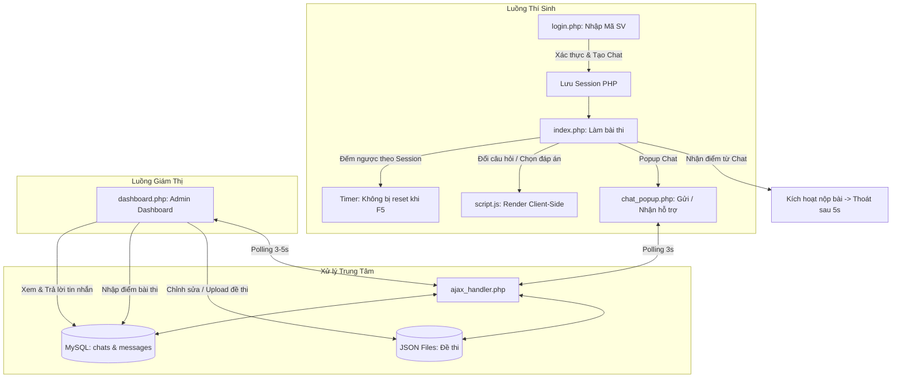

# Ứng Dụng Thi Trắc Nghiệm Trực Tuyến & Chat Hỗ Trợ Nội Bộ

Hệ thống mô phỏng cổng thi trắc nghiệm trực tuyến (giao diện chuẩn hóa của trường đại học) kết hợp tính năng hỗ trợ trực tiếp qua kênh chat thời gian thực (real-time chat widget) và quản lý ngân hàng câu hỏi đề thi linh hoạt dưới dạng JSON.

---

## 📑 Mục lục
1. [Tổng quan dự án](#1-tổng-quan-dự-án)
2. [Cấu trúc thư mục & Tệp tin](#2-cấu-trúc-thư-mục--tệp-tin)
3. [Kiến trúc & Luồng hoạt động](#3-kiến-trúc--luồng-hoạt-động)
   - [3.1. Luồng Thí sinh (Làm bài thi)](#31-luồng-thí-sinh-làm-bài-thi)
   - [3.2. Luồng Giám thị / Quản trị viên (Dashboard)](#32-luồng-giám-thị--quản-trị-viên-dashboard)
   - [3.3. Cơ chế Khôi phục & Trực tuyến của Chat](#33-cơ-chế-khôi-phục--trực-tuyến-của-chat)
4. [Cấu trúc Cơ sở dữ liệu & Ngân hàng câu hỏi](#4-cấu-trúc-cơ-sở-dữ-liệu--ngân-hàng-câu-hỏi)
5. [Yêu cầu hệ thống & Hướng dẫn triển khai](#5-yêu-cầu-hệ-thống--hướng-dẫn-triển-khai)

---

## 1. Tổng quan dự án

- **Mục tiêu:** Cung cấp môi trường kiểm tra trắc nghiệm với giao diện mô phỏng trung thực hệ thống khảo thí thực tế, đi kèm widget nhắn tin nội bộ kín đáo (ẩn danh / mờ nhẹ) giúp liên lạc với giám sát viên.
- **Công nghệ cốt lõi:**
  - **Backend:** PHP thuần (Native PHP) sử dụng PDO.
  - **Frontend:** HTML5, CSS3, JavaScript thuần (Vanilla JS), SVG icons nhúng trực tiếp.
  - **Cơ sở dữ liệu:** MySQL (lưu trữ phiên chat và lịch sử tin nhắn) + Tệp JSON cục bộ (ngân hàng đề thi).
  - **Giao tiếp dữ liệu:** AJAX (Fetch API) với kiến trúc router tập trung, polling được tối ưu hóa cho hosting chia sẻ (như InfinityFree/cPanel/XAMPP).

---

## 2. Cấu trúc thư mục & Tệp tin

```
sinhvien/
├── config.php            # Cấu hình kết nối MySQL (PDO) & các hàm CRUD tự động
├── ajax_handler.php      # Bộ định tuyến AJAX tập trung (xử lý chat, đề thi, chấm điểm)
├── login.php             # Giao diện đăng nhập, tra cứu mã sinh viên, khởi tạo phòng thi
├── index.php             # Giao diện làm bài thi chính (đồng hồ đếm ngược, câu hỏi, tiến độ)
├── dashboard.php         # Bảng điều khiển quản trị (quản lý chat, chấm điểm, sửa đề thi JSON)
├── logout.php            # Hủy phiên làm việc (Session destroy) và quay về trang đăng nhập
├── chat_popup.php        # Widget khung chat dạng popup nhúng vào các trang
├── script.js             # Logic xử lý giao diện bài thi phía client (render, pagination, chat polling)
├── style.css             # Định dạng giao diện hệ thống thi trắc nghiệm
├── check_php.php         # Công cụ kiểm tra môi trường & extension của PHP
├── font/                 # Phông chữ số hóa điện tử cho đồng hồ LED (DS-DIGIB.TTF, ...)
├── img/                  # Tài nguyên hình ảnh (ảnh đại diện thí sinh, icon)
└── *.json                # Các bộ đề thi mẫu (dau_tu_chung_khoan.json, mang_may_tinh.json, ...)
```

---

## 3. Kiến trúc & Luồng hoạt động



### 3.1. Luồng Thí sinh (Làm bài thi)

1. **Đăng nhập (`login.php`):**
   - Thí sinh nhập **Mã sinh viên**.
   - Client tự động đối soát với danh sách `studentDB` trong mã script để điền đúng **Họ và tên** (chế độ chỉ đọc). Cơ chế này giúp bảo mật danh sách lớp thi, tránh lộ thông tin những thí sinh khác nếu có người kiểm tra.
   - Thí sinh chọn mã bài thi, môn thi (dựa trên danh sách file `.json`), thời gian làm bài và số lượng câu hỏi giới hạn.
   - Khi bấm **Vào thi**, hệ thống tự tạo một phòng chat (`chat_id`) gắn liền với phiên của thí sinh và chuyển tiếp sang `index.php`.

2. **Làm bài thi (`index.php` + `script.js`):**
   - **Tải đề:** Tải dữ liệu từ file JSON tương ứng ở phía server, cắt đúng số lượng câu hỏi đã thiết lập (`question_limit`).
   - **Đồng hồ đếm ngược (Timer):**
     - Lưu mốc thời gian bắt đầu vào `$_SESSION['exam_start_time']`.
     - Mỗi lần thí sinh **tải lại trang (F5/Reload)**, thời gian còn lại được tính dựa trên hiệu số: `Thời gian tối đa - (Thời gian hiện tại - Thời gian bắt đầu)`. Đảm bảo thời gian không bị làm mới khi gian lận tải lại trang.
     - Khi hết thời gian, đồng hồ khóa ở `00:00` và chuyển màu cảnh báo đỏ.
   - **Giao diện câu hỏi:**
     - Tiêu đề câu hỏi phân dòng rõ ràng: Dòng trên là số thứ tự câu (in đậm `Câu X:`), dòng dưới là nội dung câu hỏi (chữ thường).
     - Lưới 4 đáp án (A, B, C, D) hỗ trợ chọn và bỏ chọn trực tiếp.
     - Thanh tiến độ (Progress bar) tự động tăng giảm theo tỷ lệ số câu đã trả lời.
     - Phân trang dạng trượt (Sliding Pagination) hiển thị các câu lân cận cùng modal danh sách đầy đủ khi nhấn biểu tượng menu.
   - **Chế độ toàn màn hình:** Tự động gửi yêu cầu bật toàn màn hình (Fullscreen) khi người dùng tương tác trang.

3. **Nộp bài & Nhận kết quả:**
   - Nút **Nộp bài** mặc định bị vô hiệu hóa (`disabled`) để đảm bảo thí sinh hoàn tất theo đúng quy trình.
   - Khi giám thị chấm điểm từ bảng điều khiển, client nhận điểm qua polling chat -> nút Nộp bài tự động kích hoạt (chuyển sang màu xanh đậm) -> Khi click sẽ hiển thị thông báo điểm và tự động gọi `logout.php` để thoát sau 5 giây.

---

### 3.2. Luồng Giám thị / Quản trị viên (Dashboard)

Truy cập qua `dashboard.php`, tích hợp 2 chế độ điều phối:

#### A. Quản lý Chat Support
- Danh sách các phiên chat hiển thị theo trạng thái (`waiting`, `attached`, `graded`, `closed`).
- Giao diện chat dạng hai cột trực quan: Hỗ trợ trao đổi tin nhắn trực tiếp với thí sinh.
- **Nút "Hoàn thành":** Cho phép giám thị nhập điểm trực tiếp cho thí sinh, đổi trạng thái phòng sang `graded` và gửi một thông báo hệ thống kèm điểm số tới bài thi của thí sinh.

#### B. Quản lý Đề thi (JSON Editor)
- **Tạo đề thi mới:** Nhập tên file không dấu -> Tạo khung JSON rỗng.
- **Upload file JSON:** Tải tệp `.json` từ máy tính lên máy chủ.
- **Biên tập trực tiếp (Textarea):**
  - Không cần nhập biểu mẫu từng câu phức tạp, giám thị có thể dán (paste) trực tiếp toàn bộ chuỗi JSON câu hỏi vào khung soạn thảo.
  - Tích hợp kiểm tra cú pháp JSON tự động theo thời gian thực (viền xanh khi hợp lệ kèm số lượng câu hỏi, viền đỏ khi có lỗi cú pháp).
  - Có nút **"Định dạng"** để tự động chuẩn hóa cấu trúc (indent 4 spaces).

---

### 3.3. Cơ chế Khôi phục & Trực tuyến của Chat

- **Bộ định tuyến tập trung (`ajax_handler.php`):** Hợp nhất toàn bộ các thao tác `create`, `fetch`, `send`, `recover`, `grade`, `delete` giúp loại bỏ hoàn toàn việc trùng lặp code giữa các trang.
- **Chu kỳ Polling tiết kiệm tài nguyên:** Được cấu hình trong khoảng `3000ms - 5000ms` (thay vì 500ms như trước đây), giúp giảm tới 85% lượng request, tránh việc bị các hosting miễn phí (như InfinityFree) đánh chặn vì nghi ngờ tấn công/quá tải.
- **Tự động phục hồi kết nối (`recover` / `find_replacement`):**
  - Khi phòng chat gặp sự cố ngắt kết nối hoặc giám thị gửi tín hiệu `__RECOVER__`, client của sinh viên và admin sẽ tự tạo phòng mới hoặc tự động bắt lại phòng cùng tên mà không cần thao tác lại từ đầu.

---

## 4. Cấu trúc Cơ sở dữ liệu & Ngân hàng câu hỏi

### 4.1. Bảng MySQL

#### Bảng `chats` (Quản lý phiên thi/chat)
| Cột | Kiểu | Mô tả |
| :--- | :--- | :--- |
| `id` | `VARCHAR(50)` | Khóa chính (VD: `chat_6635f...`) |
| `name` | `VARCHAR(255)` | Tên phiên (VD: `Đào Quang Tiến - mang_may_tinh`) |
| `status` | `VARCHAR(20)` | Trạng thái: `waiting`, `attached`, `graded`, `closed`, `disabled` |
| `score` | `VARCHAR(10)` | Điểm bài thi được giám thị nhập (nếu có) |
| `created_at` | `INT(11)` | Thời gian tạo (Unix timestamp) |

#### Bảng `messages` (Nội dung tin nhắn)
| Cột | Kiểu | Mô tả |
| :--- | :--- | :--- |
| `id` | `INT AUTO_INCREMENT` | Khóa chính |
| `chat_id` | `VARCHAR(50)` | Liên kết tới `chats.id` |
| `sender` | `VARCHAR(100)` | Tên người gửi (`System`, tên thí sinh, hoặc định danh hỗ trợ) |
| `text` | `TEXT` | Nội dung tin nhắn (đã qua `htmlspecialchars`) |
| `time` | `VARCHAR(10)` | Thời gian định dạng `H:i` |
| `created_at` | `INT(11)` | Thời gian gửi (Unix timestamp) |

---

### 4.2. Cấu trúc file Ngân hàng câu hỏi (`.json`)

Mỗi file môn thi là một mảng JSON chứa danh sách câu hỏi:

```json
[
  {
    "id": 1,
    "question": "Nội dung câu hỏi trắc nghiệm?",
    "options": [
      { "id": "A", "text": "Nội dung phương án A" },
      { "id": "B", "text": "Nội dung phương án B" },
      { "id": "C", "text": "Nội dung phương án C" },
      { "id": "D", "text": "Nội dung phương án D" }
    ],
    "userAnswer": null
  }
]
```

---

## 5. Yêu cầu hệ thống & Hướng dẫn triển khai

### 5.1. Yêu cầu môi trường
- **PHP:** 7.4 trở lên (khuyên dùng PHP 8.x).
- **Phần mở rộng PHP (Extensions):**
  - `pdo` & `pdo_mysql` (bắt buộc kết nối database).
  - `json` (xử lý bộ đề thi & giao tiếp AJAX).
  - `mbstring` (xử lý chuỗi tiếng Việt Unicode).
  - `fileinfo` (kiểm tra tệp tin khi upload đề thi).
  - `session` (quản trị trạng thái đăng nhập và đếm ngược bài thi).

> *Gợi ý:* Chạy file `check_php.php` trên trình duyệt (`http://localhost/sinhvien/check_php.php`) để kiểm tra tự động toàn bộ extension trước khi vận hành.

### 5.2. Cấu hình cơ sở dữ liệu
Chỉnh sửa thông số kết nối trong tệp `config.php`:
```php
$db_host = 'localhost';      // Địa chỉ máy chủ MySQL
$db_user = 'root';           // Tên đăng nhập
$db_pass = '1234';           // Mật khẩu
$db_name = 'ktra';           // Tên cơ sở dữ liệu
```

Tạo bảng bằng câu lệnh SQL:
```sql
CREATE TABLE IF NOT EXISTS `chats` (
  `id` varchar(50) NOT NULL PRIMARY KEY,
  `name` varchar(255) NOT NULL,
  `status` varchar(20) DEFAULT 'waiting',
  `score` varchar(10) DEFAULT NULL,
  `created_at` int(11) NOT NULL
) ENGINE=InnoDB DEFAULT CHARSET=utf8mb4;

CREATE TABLE IF NOT EXISTS `messages` (
  `id` int(11) NOT NULL AUTO_INCREMENT PRIMARY KEY,
  `chat_id` varchar(50) NOT NULL,
  `sender` varchar(100) NOT NULL,
  `text` text NOT NULL,
  `time` varchar(10) NOT NULL,
  `created_at` int(11) NOT NULL,
  INDEX (`chat_id`)
) ENGINE=InnoDB DEFAULT CHARSET=utf8mb4;
```
