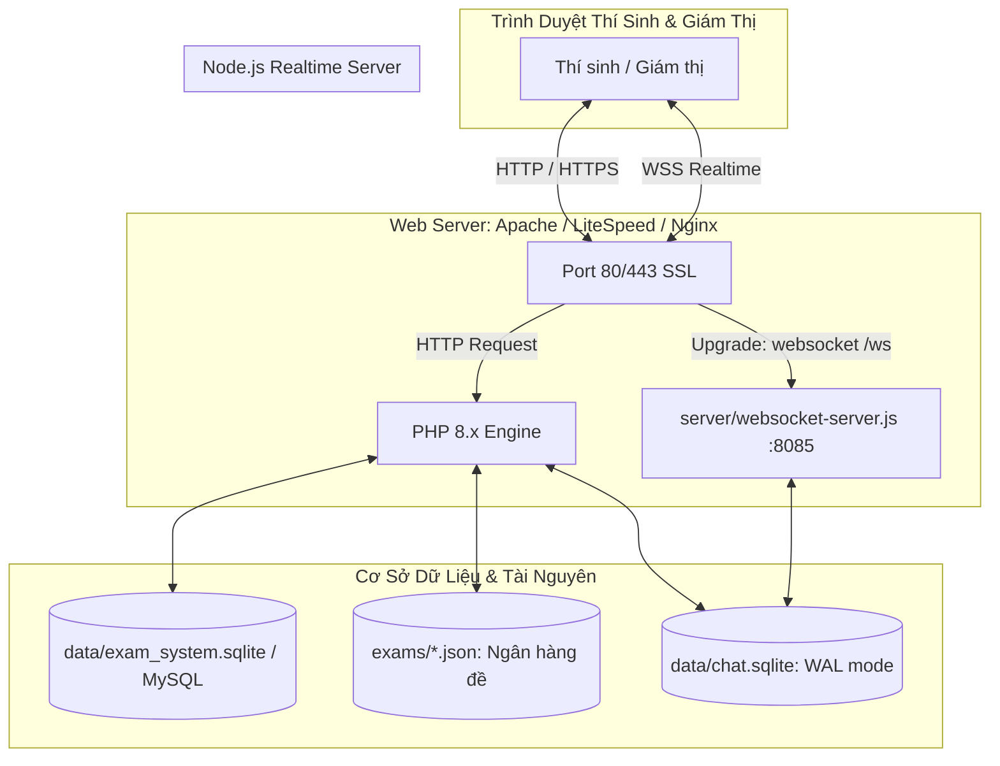

# 🎓 Cổng Thi Trực Tuyến & Hệ Thống Giám Sát Thời Gian Thực (HVU)

Hệ thống mô phỏng khảo thí trắc nghiệm trực tuyến chuẩn hóa (giao diện Đại học Hùng Vương - HVU) kết hợp máy chủ giao tiếp thời gian thực **WebSocket (Node.js)**, lưu trữ **SQLite (WAL Mode)** tốc độ cao, hỗ trợ dự phòng cơ sở dữ liệu linh hoạt (MySQL / SQLite), và bảng điều khiển quản trị - chấm thi trực tiếp.

---

## 📑 Mục lục
1. [Tổng quan & Kiến trúc hệ thống](#1-tổng-quan--kiến-trúc-hệ-thống)
2. [Cấu trúc thư mục chuẩn hóa](#2-cấu-trúc-thư-mục-chuẩn-hóa)
3. [Các tính năng nổi bật](#3-các-tính-năng-nổi-bật)
4. [Hướng dẫn triển khai đúng trên AZDIGI (Hosting cPanel)](#4-hướng-dẫn-triển-khai-đúng-trên-azdigi-hosting-cpanel)
5. [Hướng dẫn triển khai trên Cloud Server / VPS](#5-hướng-dẫn-triển-khai-trên-cloud-server--vps)
6. [Chạy và Kiểm thử trên môi trường Local / Dev](#6-chạy-và-kiểm-thử-trên-môi-trường-local--dev)
7. [Cơ chế Cơ sở dữ liệu & Tự động dọn dẹp](#7-cơ-chế-cơ-sở-dữ-liệu--tự-động-dọn-dẹp)

---

## 1. Tổng quan & Kiến trúc hệ thống

Dự án kết hợp kiến trúc **Hybrid**:
- **Giao diện & Điều phối nghiệp vụ:** PHP 8.x (Session an toàn, bảo vệ chống gian lận F5, render câu hỏi trắc nghiệm, quản trị đề thi).
- **Kênh liên lạc thời gian thực (Realtime Chat & Chấm điểm):** Máy chủ WebSocket độc lập viết bằng Node.js (`server/websocket-server.js`).
- **Cơ chế lưu trữ:**
  - **SQLite (WAL Mode):** Lưu trữ tin nhắn, phòng chat, token phiên thi và trạng thái Online/Offline tức thời, không phụ thuộc vào dịch vụ MySQL bên ngoài.
  - **MySQL (Tùy chọn):** Kết nối qua PDO, tự động fallback sang SQLite cục bộ nếu máy chủ MySQL chưa kích hoạt.
  - **JSON Storage:** Toàn bộ ngân hàng câu hỏi đề thi được quản lý dưới dạng tệp JSON tại thư mục `exams/`.



---

## 2. Cấu trúc thư mục chuẩn hóa

Thư mục gốc (Root) được tinh gọn tối đa — **chỉ giữ lại tệp `index.php`, các tệp cấu hình, và các thư mục chức năng**:

```
web-thi-hvu/
│
├── assets/                     # Toàn bộ tài nguyên tĩnh của giao diện
│   ├── css/
│   │   └── style.css           # Định dạng màn hình làm bài thi & đồng hồ LED
│   ├── js/
│   │   ├── script.js           # Logic làm bài thi, phân trang câu hỏi, tính tiến độ
│   │   └── websocket-client.js # Module WebSocket Client (tự kết nối lại, heartbeat, tick)
│   ├── font/                   # Phông chữ số hóa DS-DIGIB và Inter WOFF2
│   └── img/                    # Logo trường, ảnh đại diện thí sinh
│
├── includes/                   # Các thành phần logic dùng chung
│   ├── ajax_handler.php        # Bộ định tuyến AJAX tập trung (Chat, Đề thi, Đợt thi, Mã thi)
│   └── chat_popup.php          # Widget popup chat hỗ trợ nhúng đa trang
│
├── pages/                      # Các trang chức năng của hệ thống
│   ├── login.php               # Đăng nhập tra cứu mã SV, chọn vai trò (Thí sinh / Giám thị)
│   ├── portal.php              # Cổng thông tin khảo thí HVU (chọn ca thi, nhập mã dự thi)
│   ├── dashboard.php           # Bảng điều khiển giám thị (Realtime Chat, Chấm điểm, Quản lý đề)
│   ├── logout.php              # Xóa phiên làm việc & hủy WebSocket token
│   └── role_switch.php         # Chuyển đổi linh hoạt giữa giao diện Thí sinh và Giám thị
│
├── websocket/                  # Toàn bộ mã nguồn & cấu hình máy chủ WebSocket Node.js
│   ├── app.js                  # Entry point cho cPanel Setup Node.js App
│   ├── server.js               # Entry point thay thế
│   ├── websocket-server.js     # Máy chủ WebSocket chính (xử lý kết nối, SQLite WAL, dọn dẹp)
│   ├── package.json            # Quản lý phụ thuộc Node.js (ws, sqlite3)
│   ├── package-lock.json
│   └── node_modules/           # Thư viện Node.js được cài độc lập tại đây
│
├── backup/                     # Thư mục lưu trữ bản sao lưu mã nguồn
│   └── web-thi-hvu.zip
│
├── .gitignore                  # Bỏ qua node_modules, file database sqlite
├── .htaccess                   # Cấu hình Reverse Proxy WebSocket (/ws), URL rewrite & bảo mật
├── config.php                  # Cấu hình kết nối Database (MySQL chính & SQLite dự phòng)
├── index.php                   # Entry point chính của ứng dụng web, màn hình thi & router
├── websocket_config.php        # Cấu hình địa chỉ WebSocket tự động theo môi trường
└── README.md                   # Tài liệu hướng dẫn sử dụng & triển khai
```

---

## 3. Các tính năng nổi bật

### 3.1. Kênh hỗ trợ Realtime (WebSocket + SQLite WAL)
- **Quản lý đa tab:** Một tài khoản có thể mở nhiều tab; trạng thái chỉ chuyển sang `Offline` khi toàn bộ tab của người đó đã đóng.
- **Trạng thái trực tuyến (Presence):** Hiển thị đèn trạng thái Xanh (Online) / Xám (Offline), kèm thời điểm hoạt động cuối cùng (*Last seen*).
- **Vòng đời tin nhắn (Status Ticks):**
  - `Sent` (1 tick xám): Tin nhắn đã được gửi và lưu thành công vào SQLite.
  - `Delivered` (2 tick xám): Tin nhắn đã chuyển tới thiết bị của người nhận.
  - `Read` (2 tick xanh lam): Người nhận đã mở khung chat và đọc tin nhắn.
- **Chấm điểm trực tiếp từ xa:** Giám thị nhập điểm trên `dashboard.php` $\rightarrow$ WebSocket gửi tín hiệu tới thí sinh $\rightarrow$ Trang thi kích hoạt nút **Nộp bài**, hiển thị điểm số và tự động hoàn tất bài thi.

### 3.2. Cổng thi & Kiểm soát thời gian làm bài
- **Giao diện chuẩn hóa HVU:** Thiết kế thanh lịch, đồng bộ font chữ hệ thống và huy hiệu trường.
- **Chống gian lận làm mới (F5):** Thời gian làm bài được tính dựa trên hiệu số thời gian thực (`elapsed = time() - exam_start_time`). Dù thí sinh tải lại trang bao nhiêu lần, đồng hồ vẫn tiếp tục đếm chính xác.
- **Phân trang trượt:** Hỗ trợ duyệt nhanh câu hỏi, kiểm tra trạng thái câu đã làm qua thanh tiến độ (*Progress Bar*).

---

## 4. Hướng dẫn triển khai đúng trên AZDIGI (Hosting cPanel)

### ⚠️ Lưu ý lỗi: `Directory "public_html" not allowed`
Trên cPanel (CloudLinux Setup Node.js App), hệ thống **nghiêm cấm** đặt **Application root** trùng với thư mục gốc `public_html` (vì `public_html` đã được máy chủ LiteSpeed sử dụng để phục vụ website PHP).
👉 **Giải pháp đã tối ưu sẵn:** Toàn bộ mã nguồn, cấu hình `package.json` và entry point `app.js` của Node.js đã được gom gọn vào riêng thư mục **`websocket/`**.

### Các bước cài đặt:
1. **Upload toàn bộ mã nguồn** vào `public_html` (hoặc thư mục website của bạn trên cPanel).
2. Vào cPanel $\rightarrow$ tìm mục **Software** $\rightarrow$ chọn **Setup Node.js App**.
3. Bấm **Create Application** và điền chính xác như sau:
   - **Node.js version:** Chọn phiên bản `20.x` hoặc `18.x`.
   - **Application mode:** `Production`.
   - **Application root:** Nhập `public_html/websocket` (nếu cPanel báo lỗi đường dẫn thì chỉ nhập `websocket`).
   - **Application URL:** Chọn domain và gõ thêm `/ws` (ví dụ: `yourdomain.com/ws`).
   - **Application startup file:** Nhập `app.js` (hoặc `server.js`).
4. Bấm **Create**.
5. Sau khi tạo xong, cPanel sẽ tự phát hiện tệp `package.json` trong thư mục `websocket/`:
   - Bấm nút **Run NPM Install** để cài đặt thư viện `ws` và `sqlite3`.
   - Bấm **Restart** để khởi chạy WebSocket Server.

### Bước 4: Kiểm tra kết nối Reverse Proxy
Tệp `.htaccess` tại thư mục gốc `public_html` đã được cấu hình sẵn để chuyển tiếp yêu cầu WebSocket an toàn qua cổng 443 SSL:

```apache
RewriteEngine On

# Chuyển tiếp kết nối WebSocket /ws tới Node.js WebSocket Server
RewriteCond %{HTTP:Upgrade} =websocket [NC]
RewriteCond %{HTTP:Connection} =Upgrade [NC]
RewriteRule ^ws/?(.*)$ ws://127.0.0.1:8085/$1 [P,L]

# Định tuyến các trang chức năng
RewriteRule ^(login|portal|dashboard|logout|role_switch)(\.php)?$ pages/$1.php [L,QSA]
RewriteRule ^(ajax_handler)(\.php)?$ includes/ajax_handler.php [L,QSA]
```

> **Cách thức hoạt động:** Trình duyệt kết nối tới `wss://tenmiencuaban.com/ws` $\rightarrow$ LiteSpeed nhận diện và chuyển tiếp nội bộ tới máy chủ Node.js đang chạy trên cổng `8085`. Tệp `websocket_config.php` đã được lập trình để tự động nhận diện chế độ này!

---

## 5. Hướng dẫn triển khai trên Cloud Server / VPS

Trên VPS (Ubuntu/Debian), đây là môi trường tối ưu nhất cho kết nối WebSocket lâu dài.

### Bước 1: Cài đặt Node.js & PM2
```bash
curl -fsSL https://deb.nodesource.com/setup_20.x | sudo -E bash -
sudo apt install -y nodejs nginx certbot python3-certbot-nginx
sudo npm install -g pm2
```

### Bước 2: Khởi chạy WebSocket Server bằng PM2
```bash
cd /var/www/web-thi-hvu
npm install
pm2 start server/websocket-server.js --name "hvu-websocket"
pm2 save
pm2 startup
```

### Bước 3: Cấu hình Nginx Reverse Proxy
Chỉnh sửa cấu hình Nginx (ví dụ `/etc/nginx/sites-available/thi.yourdomain.com`):
```nginx
server {
    server_name thi.yourdomain.com;
    root /var/www/web-thi-hvu;
    index index.php index.html;

    # Xử lý PHP thông thường
    location ~ \.php$ {
        include snippets/fastcgi-php.conf;
        fastcgi_pass unix:/var/run/php/php8.2-fpm.sock;
    }

    # Chuyển tiếp WebSocket qua đường dẫn /ws
    location /ws {
        proxy_pass http://127.0.0.1:8085;
        proxy_http_version 1.1;
        proxy_set_header Upgrade $http_upgrade;
        proxy_set_header Connection "upgrade";
        proxy_set_header Host $host;
        proxy_set_header X-Real-IP $remote_addr;
        proxy_set_header X-Forwarded-For $proxy_add_x_forwarded_for;
        proxy_read_timeout 86400s;
        proxy_send_timeout 86400s;
    }

    # Bảo vệ dữ liệu SQLite
    location ~* \.(sqlite|sqlite3|db)$ {
        deny all;
    }
}
```
Kích hoạt SSL miễn phí:
```bash
sudo certbot --nginx -d thi.yourdomain.com
```

---

## 6. Chạy và Kiểm thử trên môi trường Local / Dev

### Khởi động nhanh dự án
1. Khởi tạo cơ sở dữ liệu ban đầu:
   ```bash
   php scripts/init_db.php
   ```
2. Mở cửa sổ dòng lệnh thứ nhất chạy máy chủ PHP:
   ```bash
   php -S 127.0.0.1:8000 index.php
   ```
3. Mở cửa sổ dòng lệnh thứ hai chạy máy chủ WebSocket:
   ```bash
   node websocket/app.js
   # Hoặc: cd websocket && npm start
   ```
4. Mở trình duyệt và truy cập: `http://127.0.0.1:8000`

### Tài khoản đăng nhập mẫu
| Vai trò | Mã sinh viên / ID | Họ và tên | Chức năng |
| :--- | :--- | :--- | :--- |
| **Thí sinh** | `235D150109` | Đào Quang Tiến | Vào thi, chat hỗ trợ, nộp bài |
| **Thí sinh** | `235D150052` | Nguyễn Hoàng Nam | Vào thi, chat hỗ trợ, nộp bài |
| **Giám thị** | Chọn vai trò `support` trên màn hình đăng nhập | Bất kỳ | Giám sát, chat, chấm điểm, sửa đề |

### Chạy kiểm thử tự động (Automated Test Suite)
Hệ thống tích hợp sẵn kịch bản kiểm thử toàn diện:
```bash
node scripts/test_system.js
# Hoặc: cd websocket && npm test
```
*Kết quả kiểm thử bao gồm 24 bài kiểm tra tự động:*
- Đăng nhập & cấp phát PHP Session.
- Khảo sát giao diện Cổng khảo thí HVU.
- Xác thực mã dự thi & đồng bộ phiên với cơ sở dữ liệu.
- Tải trang thi, đồng hồ đếm ngược, render câu hỏi 2 dòng chuẩn hóa.
- Xác thực WebSocket 2 chiều Thí sinh $\leftrightarrow$ Giám thị.
- Kiểm tra vòng đời gửi tin, nhận tin (Delivered), đã xem (Read), và chấm điểm Realtime.
- Kiểm tra danh sách quản lý ca thi và mã thi.

---

## 7. Cơ chế Cơ sở dữ liệu & Tự động dọn dẹp

1. **Chế độ WAL (Write-Ahead Logging) trên SQLite:**
   Cơ sở dữ liệu `data/chat.sqlite` được cấu hình `PRAGMA journal_mode = WAL;`, cho phép nhiều kết nối đọc và ghi đồng thời mà không bị khóa tệp (file lock).
2. **Tự động xóa tin nhắn quá 24 giờ:**
   - Máy chủ `server/websocket-server.js` tự động quét và xóa sạch các tin nhắn cũ hơn 24 giờ mỗi 60 phút một lần.
   - Bạn cũng có thể thiết lập Cron Job định kỳ chạy độc lập trên máy chủ:
     ```bash
     node scripts/clean-chat.js
     ```
3. **Bảo mật tệp dữ liệu:**
   Toàn bộ thư mục `data/` được khóa quyền truy cập HTTP trực tiếp qua tệp `data/.htaccess`, ngăn chặn mọi hành vi tải xuống cơ sở dữ liệu từ bên ngoài.
